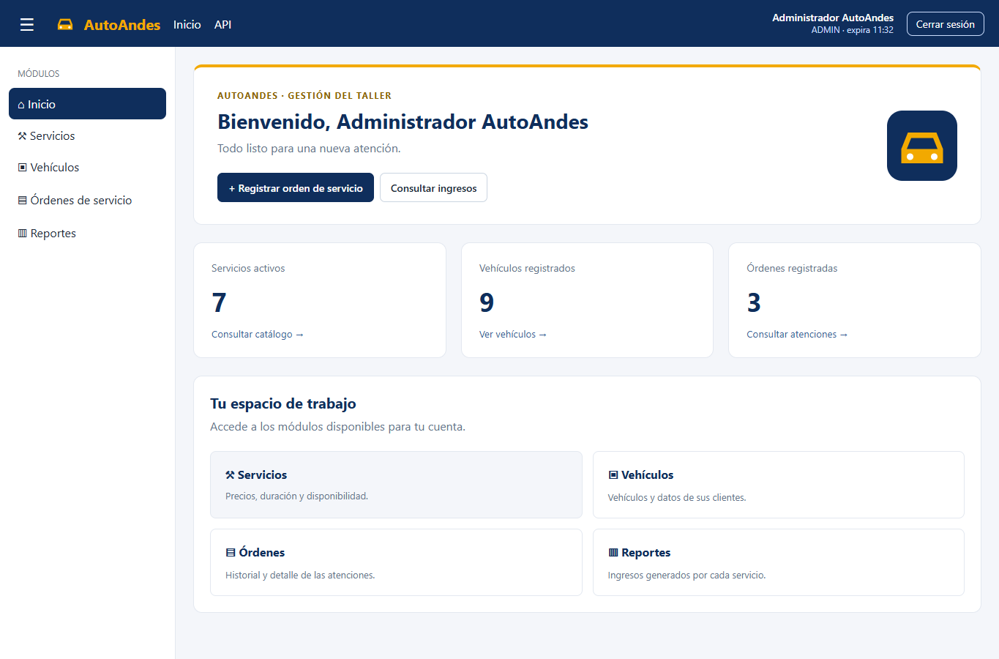

# AutoAndes Frontend

SPA Angular 22 para la recepción y gestión de un taller mecánico. Conserva el estilo azul y dorado, la estructura standalone y los patrones de sesión, navegación, formularios y permisos del proyecto de referencia Pharma.



Los resultados y capturas de las pruebas están en [docs/verificacion.md](docs/verificacion.md).

## Ejecución

Requisitos: Node 24, npm y AutoAndesBackend con Oracle en ejecución. Desde esta carpeta:

```powershell
npm ci
npm start
```

Abrir `http://localhost:4200`. La API está configurada como `http://localhost:8080/api/v1` en `src/environments/environment.ts` y `environment.development.ts`. El backend permite el origen `http://localhost:4200` mediante CORS.

Repositorios:

- Backend: https://github.com/branpachman-lang/autoandes-backend
- Frontend: https://github.com/branpachman-lang/autoandes-frontend

## Usuarios de prueba

| Usuario  | Contraseña del entorno de examen | Permisos principales                                           |
| -------- | -------------------------------- | -------------------------------------------------------------- |
| admin    | Auto2026*                        | Todas las operaciones                                          |
| asesor   | Auto2026*                        | Vehículos y registro/consulta de órdenes; lectura de servicios |
| jefe     | Auto2026*                        | Catálogo, consulta/anulación de órdenes y reportes             |
| inactivo | Auto2026*                        | Login rechazado                                                |

Las cuentas y los datos se crean mediante la migración del backend; la SPA no contiene catálogos simulados ni listas de clientes escritas a mano.

## Organización

```text
src/app/
  core/
    auth/          AuthService y modelos de sesión
    config/        menú por permisos
    guards/        authGuard, invitadoGuard, permisoGuard
    interceptors/  Bearer de la API y tratamiento de errores 401
    models/        formato común de error
    services/      un servicio HTTP por recurso y notificaciones
    utils/         mensajes y errores de validación
  shared/
    components/    errores por campo y aviso de vencimiento
    directives/    appSiPermiso
    pages/         acceso denegado y página 404
  layout/          header, sidebar y main-layout
  features/
    auth/          login fuera del layout
    inicio/        resumen consultado al backend
    clientes/      modelo para listas desplegables
    servicios/     lista, búsqueda, formulario de alta/edición, estado y eliminación
    vehiculos/     lista, filtro por cliente y formulario de alta/edición
    ordenes/       registro dinámico, consulta, detalle y anulación
    reportes/      ingresos por servicio y rango de fechas
```

Cada feature carga sus rutas o componentes de forma diferida. Los Request y Response de TypeScript corresponden al contrato del backend. La consulta de vehículos muestra el nombre del cliente y las listas desplegables se cargan mediante HTTP.

La orden usa un FormArray de 1 a 10 líneas, servicios sin repetir y cantidades de 1 a 5. La vista previa recalcula subtotales y total, pero la solicitud solo envía vehículo, kilometraje, servicio y cantidad. El backend determina precios, total, estado, fecha y usuario. Un 409 conserva el formulario y sus líneas.

## Seguridad

La sesión se mantiene con signals y `sessionStorage`, incluyendo su vencimiento. Se cierra automáticamente al expirar y se puede cerrar desde el encabezado. Un interceptor agrega el token únicamente a la API. Un 401 de la API fuera del login cierra la sesión y conserva returnUrl; un 403 mantiene la sesión.

Los guards bloquean rutas sin sesión o sin permiso, aunque se escriba la URL directamente. El menú y los botones también consultan permisos. La protección definitiva permanece en Spring Security.

## Pruebas

```powershell
npm test -- --watch=false
npm run build
```

Las pruebas unitarias verifican almacenamiento y expiración de sesión, guards, alcance del token, 401/403, cálculos del formulario, solicitud sin precios ni total, servicios repetidos y conservación del detalle ante un 409.

Para pruebas integradas con navegador, mantener Oracle y el backend iniciados y tener Google Chrome instalado:

```powershell
npm run test:e2e
```

Playwright inicia Angular automáticamente si el puerto 4200 está disponible. Las cinco pruebas verifican CRUD, relación a clientes, duplicados, registro cabecera-detalle, anulación, reporte, permisos, tokens alterados/vencidos, acceso denegado, página 404 y pantalla móvil.

`E2E_API_URL`, `E2E_BASE_URL` y `E2E_PASSWORD` permiten cambiar las direcciones o contraseña del entorno de pruebas. Los resultados y las trazas quedan en `playwright-report/` y `test-results/`, excluidos de Git porque pueden contener datos de sesión. Las capturas seleccionadas del entorno de examen se guardan en `docs/evidencias/`.

Las pruebas crean recursos auxiliares de CRUD y los eliminan durante el recorrido exitoso. La orden de evidencia se anula y conserva para inspección. Si se interrumpe una prueba, revisar los recursos de prueba antes de repetirla.

## Versionado

Ramas `main`, `develop` y `examen-a-pacho`. La entrega se identifica con `v1.0-examen-u2`. Los commits separan configuración, CRUD, órdenes/seguridad y verificación. Las credenciales locales del backend y las trazas de navegador no forman parte de los repositorios públicos.
